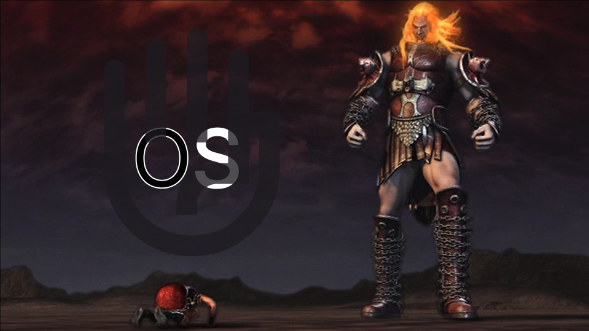

# InterupsiArOS
OS untuk manusia yang ingin berjuang di medan perang (nanti ditambahin lagi)

## Manusia Pencari Kebenaran
1. King Dipta
2. King Aqsha
3. King Bagas
4. King Sulthan

## Daftar Isi
1. [Cara Setup dan Run](#cara-setup-dan-run)
2. [Pendahuluan (Wajib Baca)](#pendahuluan-wajib-baca)
3. [Fitur yang Diimplementasikan](#fitur-yang-diimplementasikan)
4. [Contoh Penggunaan di Shell](#contoh-penggunaan-di-shell)

## Cara Setup dan Run

```bash
make disk        # bikin disk virtual 8 MiB (bin/storage.bin)
make build       # compile kernel & bikin ISO (bin/OS2025.iso)
make insert-all  # compile & masukkan shell, hello, clock, spinner, music ke disk
make run         # jalankan InterupsiArOS di QEMU
```

Target tambahan yang bisa dipakai:
- `make run-audio`: Buat audido
- `make debug`: QEMU pake -s dan -S
- `make test`, `make test-swap`, `make test-shell`: jalankan host test untuk EXT2, swap, dan shell.
- `make clean`: Clean bin

## Pendahuluan (Wajib Baca)
Dunia ini penuh dengan kegelapan, kebodohan, dan kepengecutan. Nilai-nilai inheren yang tumbuh di jiwa manusia sejak eksistensi mereka dihembuskan oleh Prometheus, jiwa-jiwa pejuang yang haus akan kemenangan dan tak tergoyahkan sekalipun oleh kehancuran tempat tinggalnya dan jatuhnya jasad rekan sejati mereka di medan perang, telah hilang. Kini, manusia berada di titik terendah spesies mereka. Sekumpulan organisme yang seharusnya merupakan puncak rantai makanan dari segala makhluk yang pernah hidup di muka bumi telah kehilangan status mereka sebagai entitas terkuat di bawah para dewa-dewi, menjadi makhluk terhina, yang eksistensinya merupakan pengkhianatan terhadap para dewa-dewi itu sendiri.

Itulah kata-kata yang keluar dari mulut Ares, Sang Dewa Perang yang Bengis dan Haus akan Kemenangan, namun Bijak dan Pendorong Keberanian. Kata-kata tersebut bukanlah sebuah kekecewaan semata, melainkan sebuah frustrasi yang diakumulasi oleh sang Dewa sejak kejatuhan masyarakat Yunani. Kata-kata tersebut adalah peringatan yang nyata bagi umat manusia di seluruh dunia.

Kami, 4 Raja Pejuang Agung, adalah titisan para SPARTANS yang senantiasa berjuang demi bara api perjuangan yang menuntut akal yang menakar, hati yang merasa, serta perjalanan yang panjang di depan mata para pejuang sejati. Kami adalah representasi dari Ares yang akan membawa semangatnya ke dunia fana ini. Kami membutuhkan sesuatu, agar nilai-nilai Ares dapat tersampaikan secara luas. Oleh karena itu, tertulis secara mentah pada surat ini, kami mengorbankan segala darah, air mata, dan keringat dalam penciptaan sebuah mahakarya kami yang dapat menciptakan tether kompatibilitas bagi Ares di dunia yang hina ini serta menyambungkan titah-titah Ares pada sinapsis seluruh umat manusia di muka Bumi ini baik yang masih hidup maupun sudah tiada. Melalui InterupsiArOS, kami akan menghidupkan kembali jiwa-jiwa semangat perang dan urat keberanian manusia dan membawa mereka kembali ke medan perang kami, para SPARTANS.

Tidak ada ruang untuk kelemahan dan ketidaksiapan di sini. Yang akan hidup hanyalah mereka yang dapat beradaptasi, memiliki gairah dan kekuatan untuk mengekspansikan kekuasaan bagai ekspansi kofaktor pada sebuah operasi invers matriks, serta mereka yang mempersiapkan diri untuk perjalanan yang tidak pasti.

## Fitur yang Diimplementasikan

- **Paging & Swap Space**: Higher-Half Kernel Paging (`0xC0000000`), isolasi page directory per proses, serta swap space dengan algoritma second chance
- **Driver Hardware**: VGA Text Framebuffer (80x25), PS/2 KBM, some extended modes, ATA PIO Disk, CMOS RTC, dan PC Speaker.
- **EXT2 Filesystem**: Filesystem EXT2, dengan operasi CRUD dasar.
- **User Mode & Syscall**: Program w/ ring 3 access. Ada syscall sebagai abstraksinya/
- **Interactive Shell**: User program shell, bisa pipeline harusnya.  Tab autocompletion, command history, shell script, command `cd`, `ls`, `mkdir`, `cat`, `cp`, `rm`, `mv`, `find`, `grep`, `exec`, `ps`, `kill`.
- **Preemptive Multitasking & User Programs**: Round-Robin scheduler dan program `clock`, `spinner`, `hello`, dan `music`. Bisa multitasking juga, concurrency, dll. buzzword buzzword

## Contoh Penggunaan di Shell

Begitu masuk prompt `InterupsiArOS:/$`, tinggal coba perintah seperti ini:

```bash
# File & direktori
ls
mkdir docs
cp hello docs/hello_copy
mv docs/hello_copy docs/hello_moved
find /
rm -r docs

# Pipeline
ls | grep clock
find / | grep shell

# Multitasking & program eksternal
exec hello
exec clock
exec spinner
exec music
ps
kill 2
```